# Futsal Manager

> Jogo de gestão de futsal, feito de raiz, com clubes e jogadores **fictícios** e um motor de jogo em 2D.
> 🇬🇧 [English version](README.en.md) · 🌐 Página: [tactivagames-pt.github.io/FutsalManager-showcase](https://tactivagames-pt.github.io/FutsalManager-showcase/)

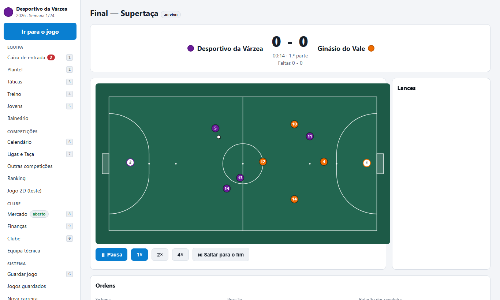

Este repositório é só uma **montra** do jogo. O código não está aqui e o jogo **não é open source**
(ver [LICENSE](LICENSE)). Serve para mostrar o projeto e procurar apoios.

## Porque é diferente
- **Futsal a sério**: quintetos, rotações, guarda-redes avançado (5x4), faltas acumuladas, livres de 10 m.
- **Ligas portuguesas** como ponto de partida (1.ª e 2.ª divisão fictícias), com taças e uma competição internacional.
- **Motor 2D**: o jogo vê-se num campo visto de cima e podes dar ordens enquanto decorre.

## Funcionalidades
- **Jogo ao vivo em 2D** com pausa, velocidades 1×/2×/4×, ordens a meio do jogo, repetições, intervalo e relatório final com mapas de remates, de calor e de passes.
- **Táticas**: funções por posição, instruções individuais e de equipa, bolas paradas.
- **Preparação do jogo**: relatório do adversário pelos olheiros e marcação individual.
- **Equipa técnica e treino**: plano semanal, treino individual, relatórios de evolução.
- **Mercado avançado**: cláusulas, empréstimos, empresários, lista de observação e missões de olheiros.
- **Balneário**: personalidades, líderes, grupos e queixas.
- **Competições**: Supertaça, Taça da Liga, competição internacional fictícia, seleções e ranking de clubes.
- **Direção e finanças**: patrocinadores, crédito, fair play financeiro e venda do clube.
- **Saves** com vários slots, tema claro/escuro e atalhos de teclado.

<table>
<tr><td>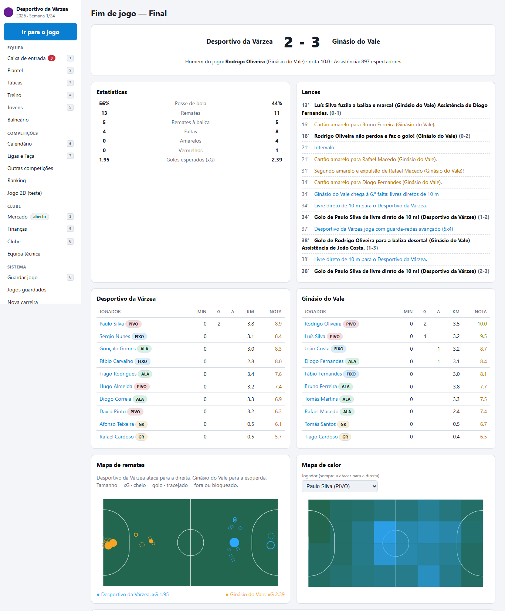</td><td>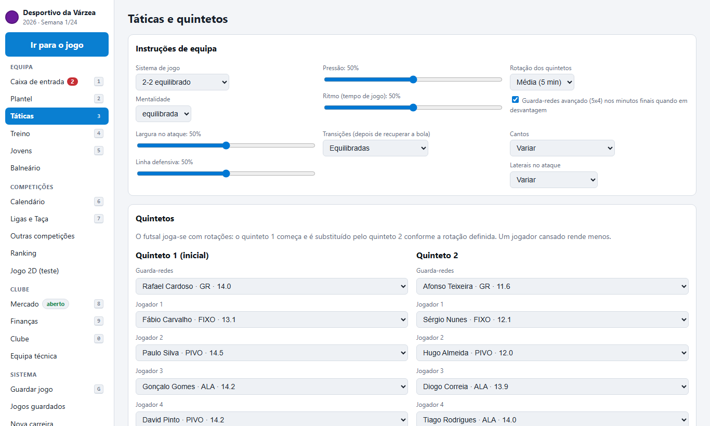</td></tr>
<tr><td>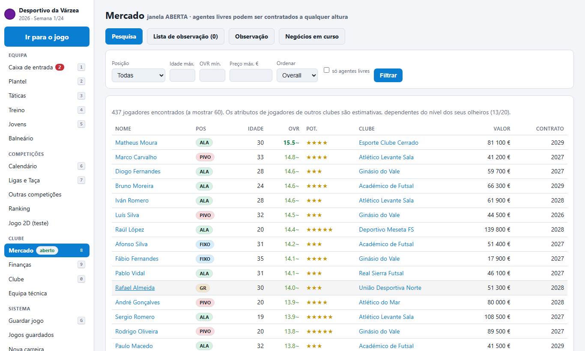</td><td>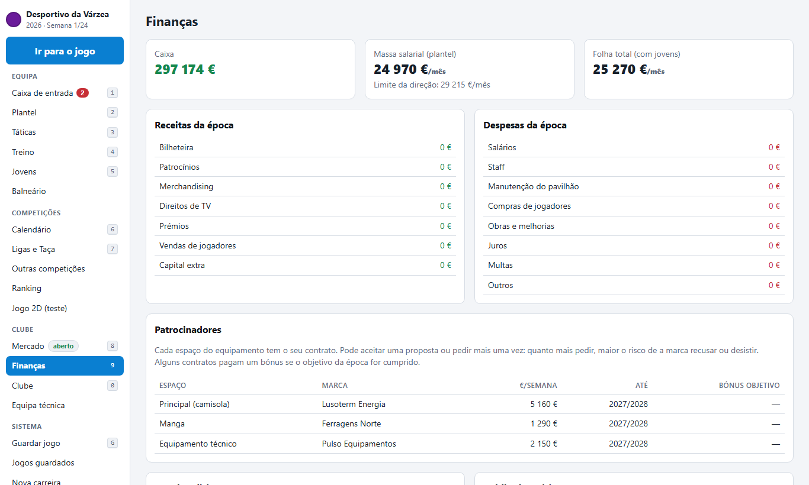</td></tr>
<tr><td>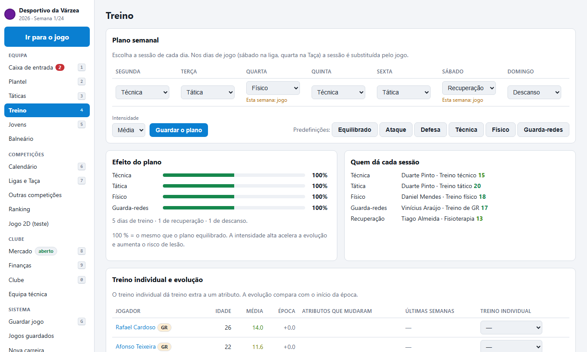</td><td>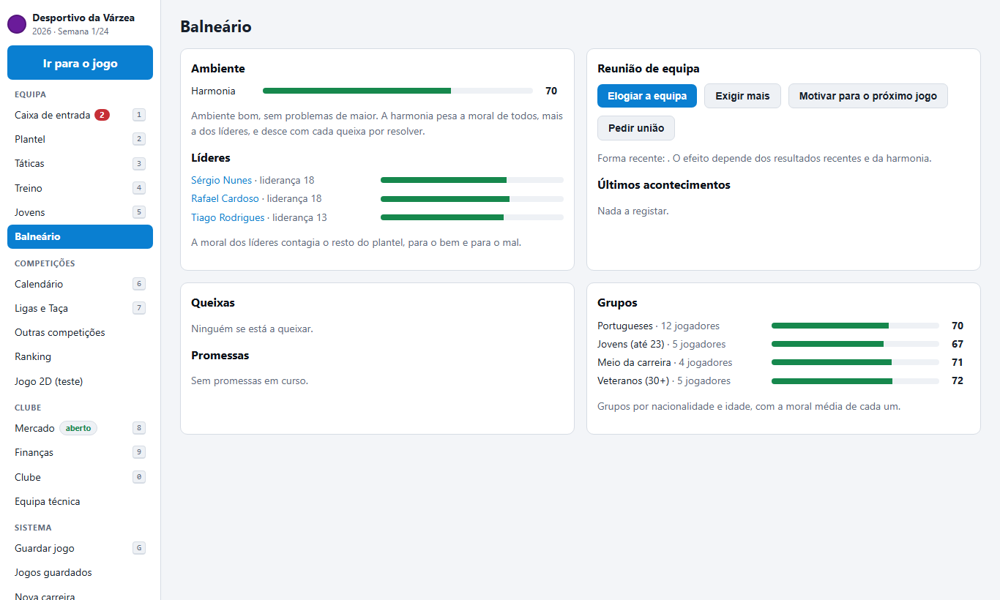</td></tr>
<tr><td>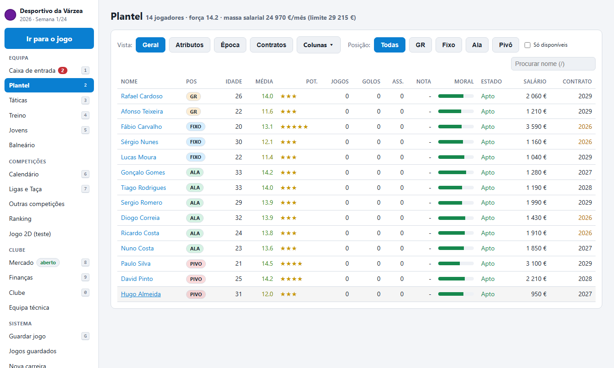</td><td>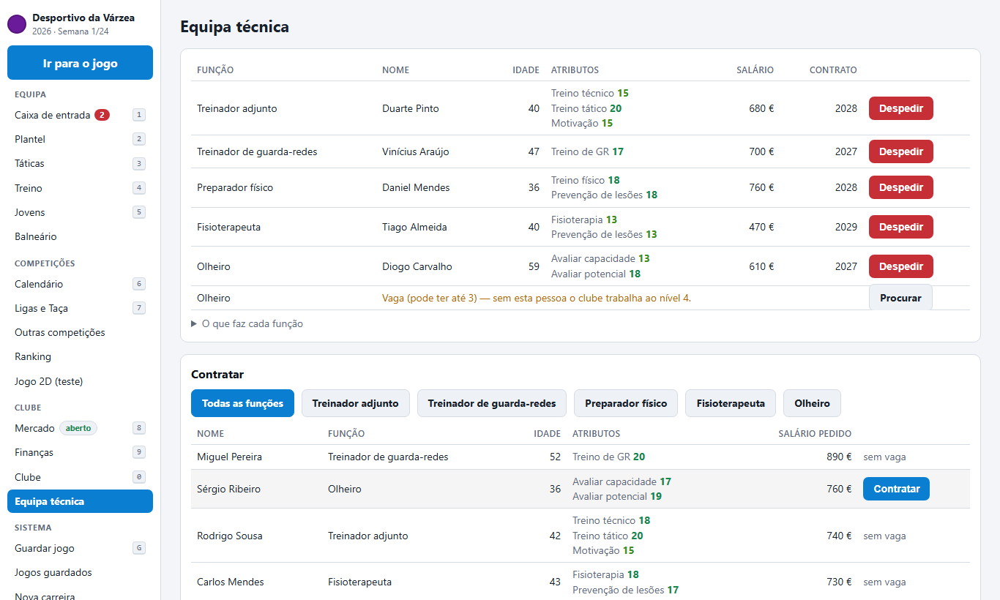</td></tr>
<tr><td>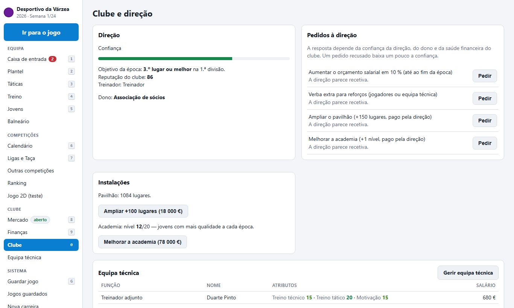</td><td>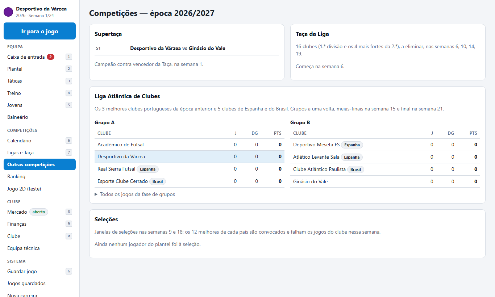</td></tr>
<tr><td>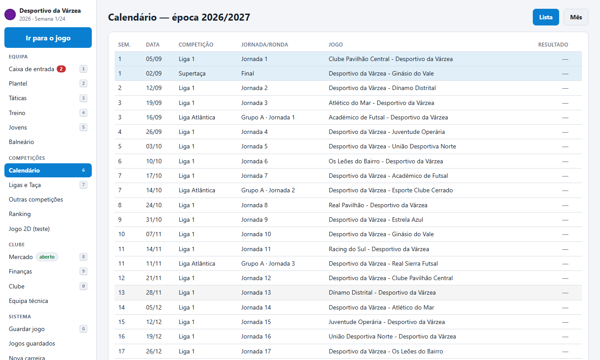</td><td></td></tr>
</table>

## Roteiro
Imprensa · carreira e hall of fame · editor de dados (ligas distritais) · versão nativa para PC · versão para telemóvel.

## Apoiar / Patrocinar
O desenvolvimento é independente. Se queres ajudar:

| Nível | O que recebes |
|---|---|
| **Apoiante** | Agradecimento público e acesso a novidades |
| **Nos créditos** | O teu nome nos créditos do jogo |
| **Clube fictício** | Um clube no jogo com o nome do teu negócio ou o teu |
| **Patrocinador principal** | Marca em destaque no jogo e neste projeto |

## Contacto
Sugestões e propostas: abre uma [issue](../../issues) neste repositório.

_Todos os clubes, jogadores e marcas do jogo são fictícios._
